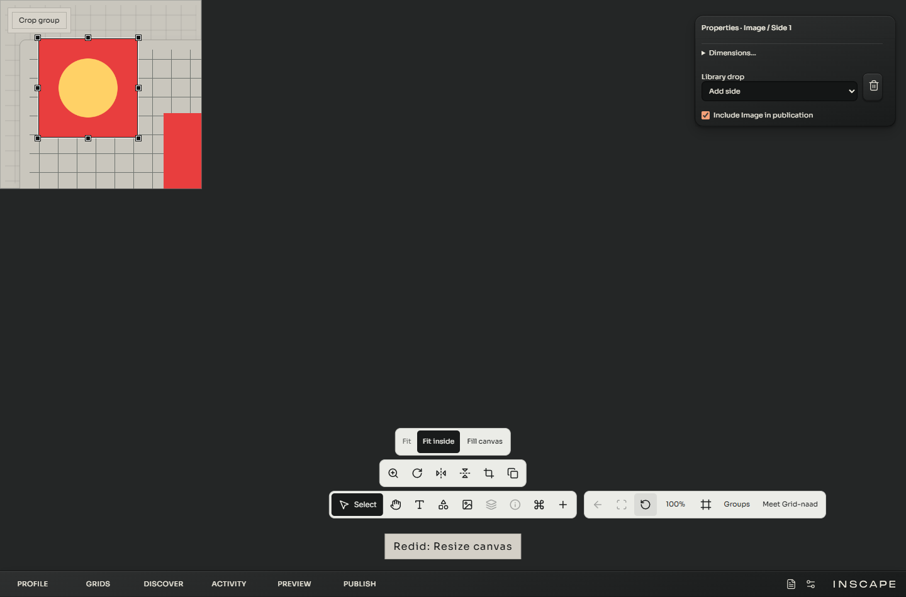
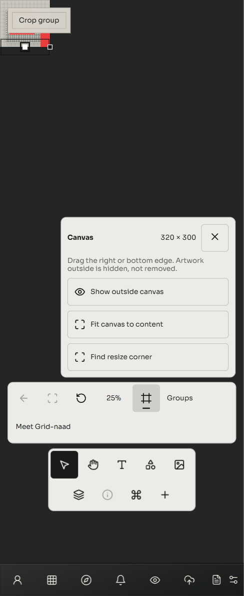
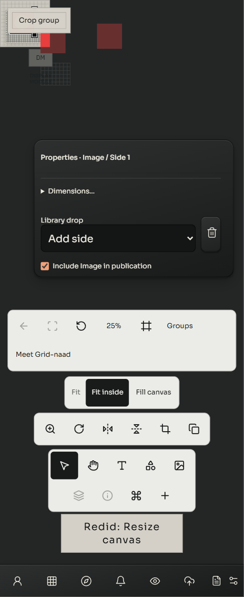

# Non-destructive Workbench canvas — 20 October 2026

Shrinking the canvas previously left artwork visible outside it, while moving that artwork forced it back inside. The founder chose non-destructive cropping. The normal owner view and public Visitor now clip authored content to the saved canvas area. Enlarging reveals the original content again. Source media, frame dimensions, image fitting, transforms and positions are preserved.

Canvas size now contains **Show outside canvas**. It reveals dimmed content for editing, resets with the owner session and is not published. Existing modules and stacks can cross each canvas edge within a separate finite editing space (-16,384 to +16,384 work pixels). Initial placement and the alignment grid still use the canvas area. Fully clipped modules cannot be clicked, keyboard-focused or marquee-selected. Selected partly clipped objects retain their editing handles.

The canvas origin remains fixed. Fit canvas to content includes right/bottom outliers; it reports an actionable error for content above/left rather than silently rearranging the composition. Explicit SVG inspection and expanded group reading retain their temporary full-content presentation; returning reinstates the crop. Cropping is visual: public documents retain their public sources and full geometry.

## Responsibilities and changes

`WorkbenchCanvasContent` owns the shared clipping plane and follows the existing camera paint subscription. It does not measure each artwork or rerender media on camera animation frames. Module components still own their geometry; canvas resize still uses the existing draft operation, undo and publication paths. The owner-only outside setting is transient, and the additional dimming canvas has no bitmap allocation while hidden.

Group stacks portal into the same clipped content plane, while tools stay in the viewport host. This exposed a selection-overlay interception during stack drops; group hit testing now looks through that overlay. Source validation accepts bounded negative positions so crossing the left/top edges survives save, publication and restore. No media optimizer, dependency, image-count limit, wallet flow or public-document field was added.

The existing ordinary Image drag still saves through the profile-local layout cache. Canvas operations and publication capture that live layout. This task does not replace that cache or claim that ordinary solo dragging gained a new undo action.

## Verification

- **1,264/1,264 Node tests**, no skipped or failed cases. This includes negative-position save, publication, restore and canvas resize; finite bounds; and the existing standards audit. [Full log](canvas-crop/node-final.log).
- **69/69 browser cases across 16 suites**, no skips in the final per-suite results. These are local Chromium fixtures; the combined record selects the latest run of each suite. [Results and source runs](canvas-crop/browser-verified.json).
- The new real-runtime crop fixture runs at 1440 and 390 CSS pixels, at DPR 1 and 1.25. It checks pointer preview/release/cancellation, keyboard resizing, Undo/Redo, unchanged source and geometry, clipped hit testing and marquee selection, outside editing without snap-back, enlarge/reveal, reload, public projection and Visitor parity. It also opens/closes live SVG inspection and a public group.
- Pixel assertions confirm the SVG paints after inspection/zoom and that the outside raster area is exactly the dark canvas surround. [Wide measurements](canvas-crop/evidence-1440.json), [narrow measurements](canvas-crop/evidence-390.json), [crop test log](canvas-crop/workbench-canvas-crop.log).
- Existing checks cover Image/Shape corner resizing, the production Grid release crash, camera navigation and Focus, groups/stacks, group publication, keyboard inspection, context bars, Index, layout reload and published Visitor rendering.
- Build, production budget checks and built-app startup pass. Initial JavaScript remains **823,811 bytes**. [Build](canvas-crop/build.log), [budget](canvas-crop/build-check.log), [startup](canvas-crop/production-startup.log).

Screenshots were inspected at both widths. The review corrected outside-area dimming, and a capture taken before an SVG reloaded was replaced with an explicit readiness wait and pixel assertions. Earlier fixture assumptions incorrectly expected dragging to write directly to the canonical draft and expected a canvas-edge hit target not to cover the test point. Those assumptions were corrected without weakening source/geometry preservation checks. Existing tests expecting visible outside content or the former canvas-bound movement now assert the accepted crop/recovery behavior.

## Scope and rollout

These checks use isolated fixture storage and local raster/SVG sources. They do not modify the founder's composition, submit a wallet action or upload a new public document. They are not a representative 16-artwork frame-time or memory benchmark; that performance check remains open.

This checkpoint contains the verified source and browser regression suite, now included in the default browser runner. Exact preview deployment and hosted CI status are recorded separately in the ongoing audit after pushing; local passing results do not certify a future hosted run.
