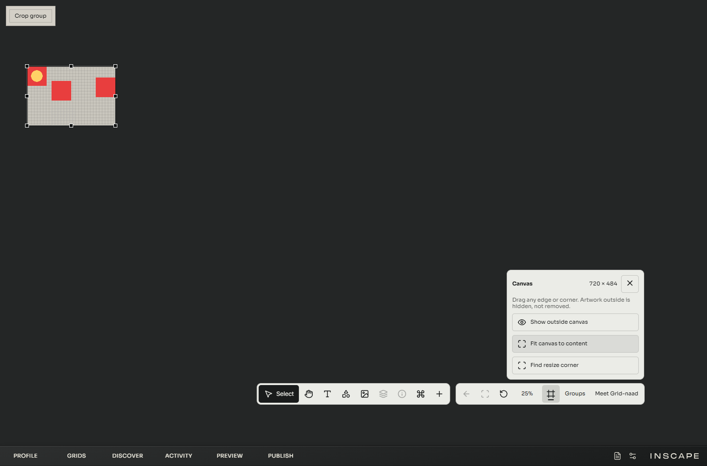
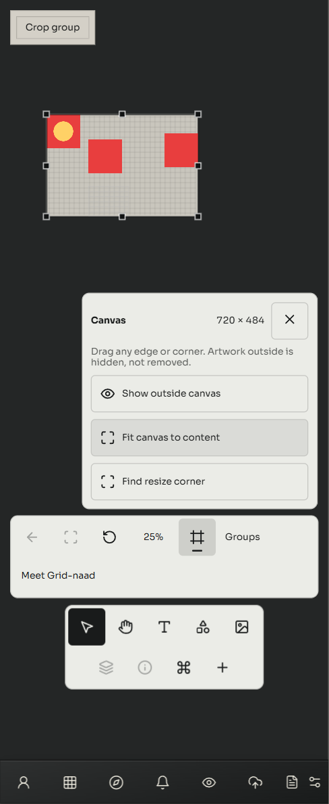

# Exact canvas Fit and resizing from every side — 20 October 2026

The founder reported that Fit canvas to content left an extra strip and that canvas resizing only exposed the right and bottom edges. Fit deliberately added 48 work pixels of trailing margin and kept the origin fixed at zero. It now fits all four registered object-frame bounds without that margin. All four edges and four corners can resize independently, including horizontal, vertical and diagonal corner gestures.

The opposite edge or corner remains anchored. Moving the canvas boundary changes the visible crop, not artwork positions, dimensions, fitting, media sources or the camera. Enlarging reveals the original content. Show outside canvas remains a temporary owner control.

## Geometry and ownership

The authored area now carries optional `left` and `top`, defaulting to zero, alongside width and height. These travel through the existing draft operation, Undo/Redo, publication and restoration; no new storage key, document version, layout translation or migration was introduced. The camera still projects world coordinates. Clipping, outside dimming, alignment bounds, visibility checks and resize controls consume this same area.

Fit uses module-owned frames and collapsed group stacks. Transparent margins inside an image are part of its frame; this is not alpha trimming. Integer bounds fit exactly. Fractional bounds round outward by less than one work pixel per edge. The old 256-pixel minimum is now 1 so small content does not gain forced padding. Maximum dimensions remain 16,384; canvas edges stay within the existing -16,384 to +16,384 editing coordinates.

## Additional regression found in hosted verification

The preceding crop commit `85c68261e3aabce80949b13d37a8807c136371fe` passed its targeted local checks but failed the full hosted browser run. The retained [PR run](https://github.com/RadarVisuals/INSCAPE/actions/runs/39403597709) artifact identifies two failures: Keeper selection/chat and Mini App settings. Both reproduced locally before this correction.

The shared clip plane had accidentally included viewport-owned surfaces. The Keeper conversation was trapped beneath context tools; Mini App settings inherited disabled pointer interaction. Mini App windows/settings/shortcuts now remain in their existing viewport host in owner and Visitor. Keeper's released actor and conversation portal to that same host; its authored dock remains canvas content. This fixes the responsibility boundary instead of bypassing clicks or removing clipping.

The existing interaction tests pass unchanged after the fix. Their wallet and chat services are fixtures: no real signature, upload or AI request occurred. [Prior failures and local reproduction](canvas-fit-edges/previous-ci.json), [Keeper failure log](canvas-fit-edges/keeper-selection-prior-ci-failure.log), [Mini App failure log](canvas-fit-edges/mini-apps-prior-ci-failure.log).

## Verification

- **1,265/1,265 Node tests**, zero failed/skipped/cancelled. Covers all eight resize directions, bounds, fractional Fit, small Fit, origin-only changes, failed persistence, stale gestures, Undo/Redo, publication and restore. [Log](canvas-fit-edges/node-final.log).
- **43/43 browser cases across 12 suites**, zero failures or skips in the final per-suite results. [Results with source runs](canvas-fit-edges/verification.json).
- Exact-fit fixture: three Images plus Shape Grid fit to **left 60, top 60, width 720, height 484**. At 25% zoom and camera offset (40,120), the clipping rectangle is exactly (55,135,180,121) CSS pixels.
- At **1440 and 390 CSS pixels**, DPR 1 and 1.25, each viewport exercises **16 pointer gestures**: four edges and each corner horizontally, vertically and diagonally. The top-left expansion reaches (-36,-36), proving it can cross the old zero origin. Each gesture checks the fixed opposite boundaries, clip projection and release-only persistence.
- Cancellation restores origin and size; Alt+ArrowRight adjusts by one work pixel; Undo/Redo, reload and Visitor preserve the saved origin. Image sources, Shape data and module geometry remain unchanged. [Wide measurements](canvas-fit-edges/fit-edges-1440.json), [narrow measurements](canvas-fit-edges/fit-edges-390.json).
- Related coverage: camera controls, area navigation, groups/stacks/public groups, Keeper/dialogue/selection, Mini Apps, context action bars, crop/inspection recovery and built-app startup.
- Production build and budget checks pass: **823,811 initial JavaScript bytes**, unchanged. [Build](canvas-fit-edges/build.log), [budget](canvas-fit-edges/build-check.log), [startup](canvas-fit-edges/production-startup.log).

Wide/narrow canvas screenshots and restored Mini App/Keeper surfaces were inspected. The canvas controls retain the existing styles, keyboard steps and responsive placement. No dependencies were added.

## Scope and rollout

The tests use isolated local storage and fixture media. They do not change the founder's composition or publish a document. They are not a representative 16-artwork performance benchmark. Ordinary solo dragging still uses the existing layout cache; this change does not redesign it.

This report records the local source/build evidence. The ongoing audit records the pushed commit, exact preview deployment and new hosted CI status separately; passing targeted tests does not certify the next full hosted run.
