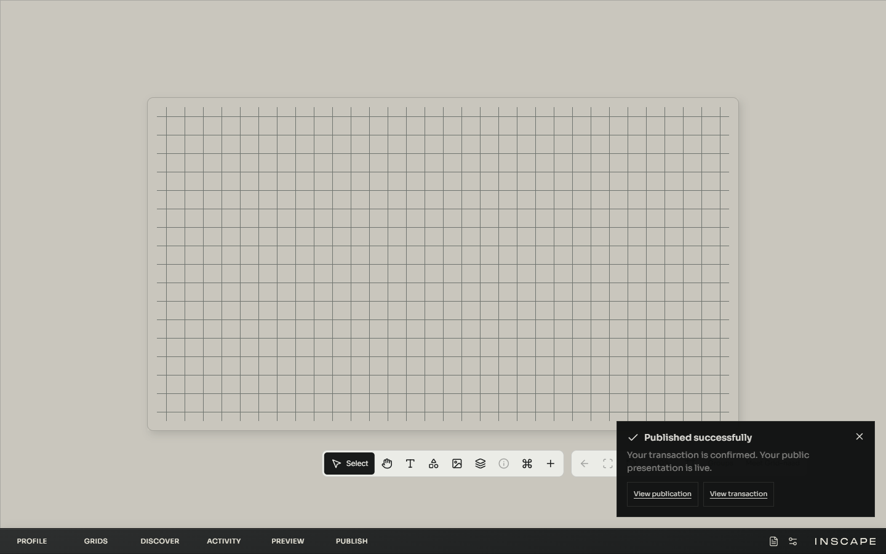
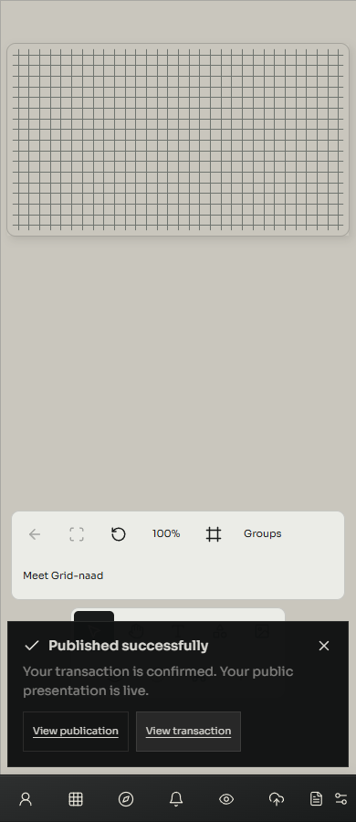

# Live publication and persistent confirmation — 20 October 2026

The founder completed the real guarded upload and Publish flow on preview `6ad6b8e17f63f72e28c10b98` (commit `4e3ccd04b9c77f3221865e51c6b5179eac868c5e`). Read-only verification found a successful receipt, the matching profile DataChanged event and current pointer, and canonical IPFS bytes with the expected hash and profile. Pinata showed the new matching file, created at 07:03:02 UTC. The visitor Canvas rendered Grid 1 before and after reload. This was a one-Shape snapshot, not a full media/performance test. No agent signature or wallet transaction was performed. The hosted quota ledger was not independently inspected. [Chain evidence](publication-confirmation/chain-readback.json), [session](publication-confirmation/session.json).

The successful callback immediately refreshed the profile, unmounting the owner runtime and its local success text. Confirmation now belongs to the application session outside that runtime. It survives refresh until dismissed, links to the public reception and transaction, and clears when leaving the owner's context. Pending transaction and read-back phases remain distinct. No publication success is shown for an upload alone or an unconfirmed transaction. Transaction transport, authority and canonical document verification remain unchanged. Styling reuses existing tokens and a body portal above the editing tools.

Validation: 1263 Node tests passed; 2 real-App publication browser cases at 1440/390 px, 9 upload cases and 5 routing cases passed. Build and production budgets passed. Tests use local fake wallets and mocked network routes; they submit nothing externally. The tests cover owner unmount/refresh, persistence without a short timeout, no duplicate action, profile context, keyboard dismissal/focus, opacity, stacking and viewport bounds. [Node](publication-confirmation/full-node-final.log), [browsers](publication-confirmation/browser-results.json), [budget](publication-confirmation/build-check-final.log).

The shared Pinata credentials remain active. The operational guide now explicitly preserves a credential used by other projects. This source checkpoint supplies the feedback fix; the real transaction above tested the preceding deployment. Live verification of the updated deployment is recorded separately.
