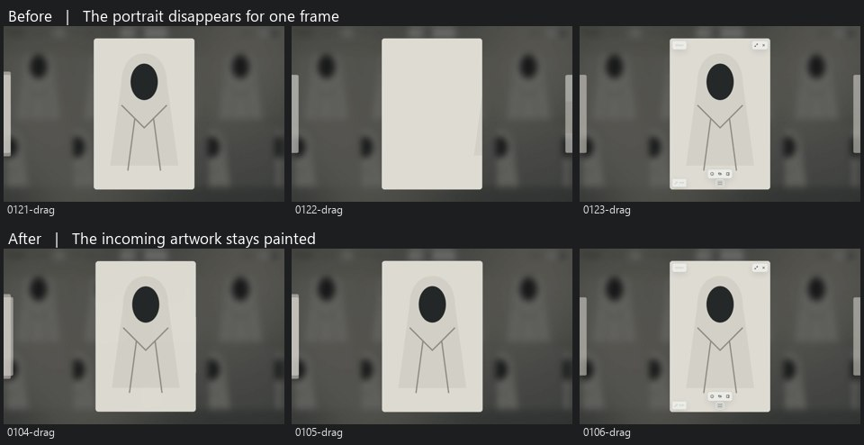
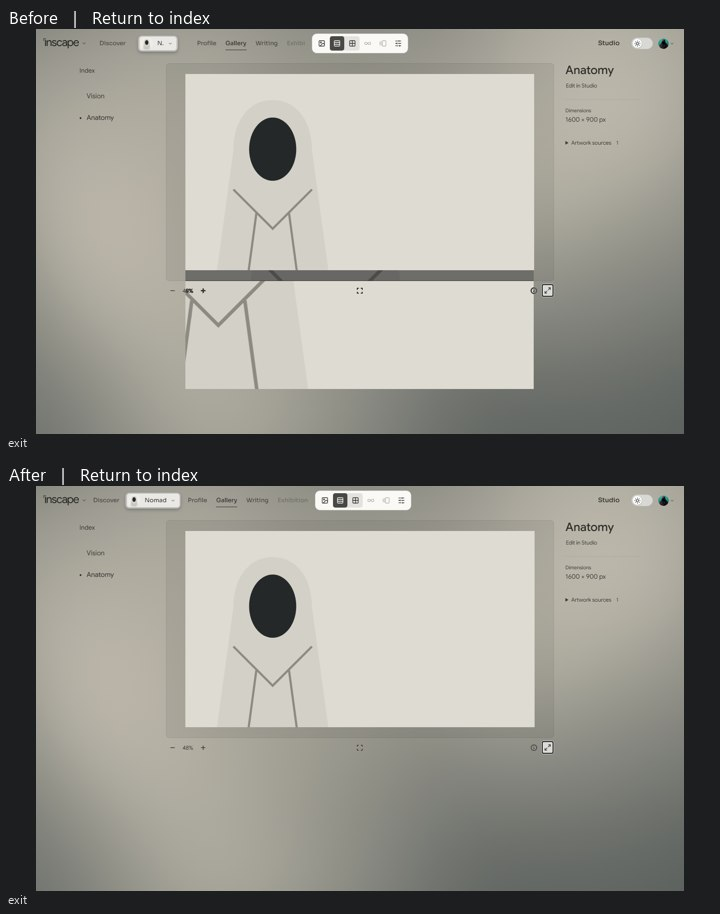
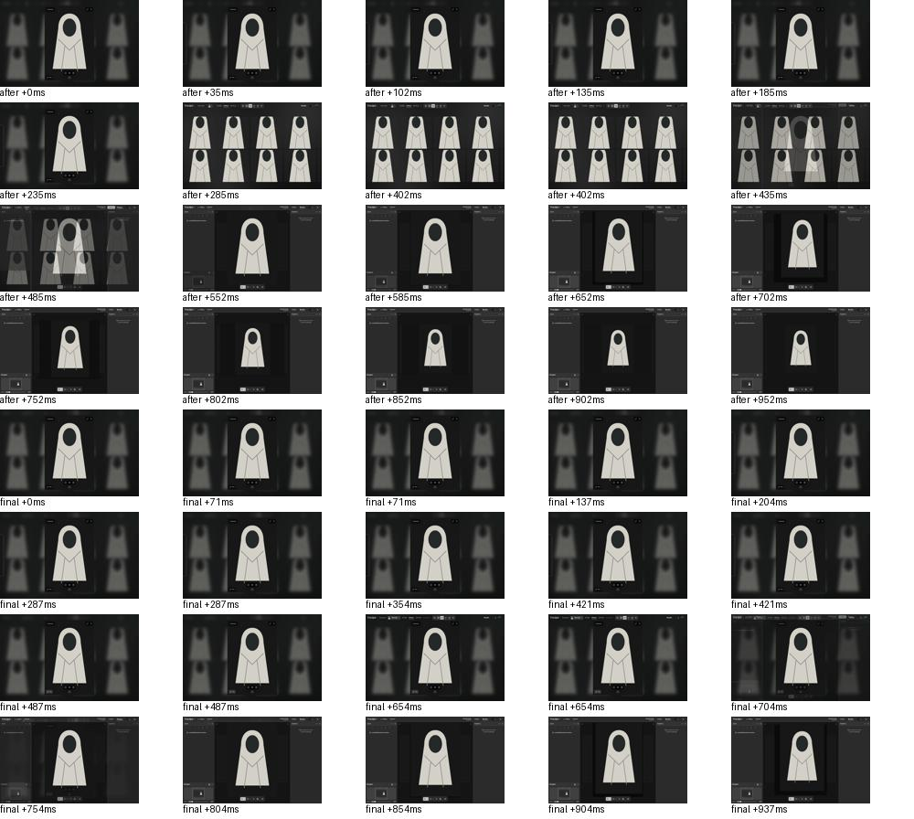
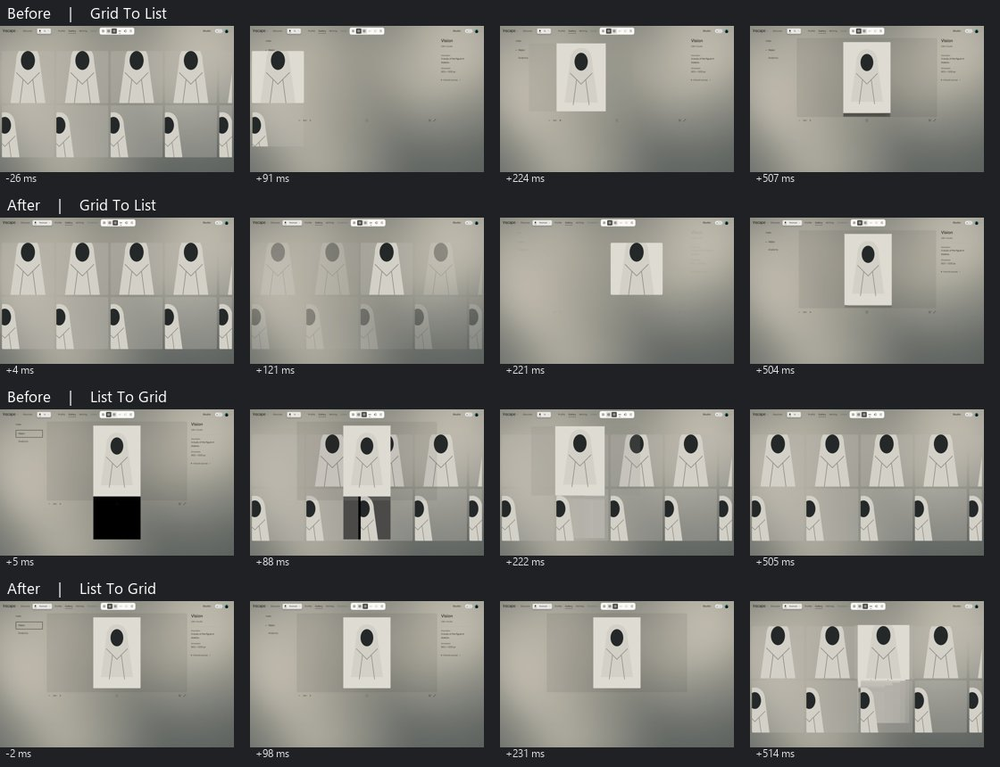
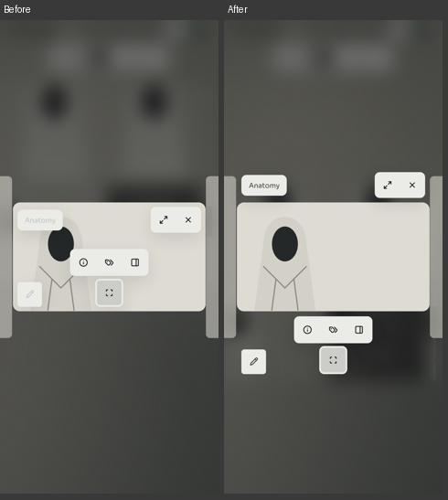

# Gallery motion and interaction review

## Baseline observations

Chromium compositor recordings used normal motion and synthetic portrait and landscape compositions. A separate interactive pass used the published founder Gallery with Kukabura and Nomad.

| Interaction | Visible defect before edits |
| --- | --- |
| List to Grid | Grid tiles appeared immediately behind the large centered work. A black area extended below the List canvas and its controls. |
| Grid to List | Surrounding tiles disappeared at once, leaving a clipped lower-left remnant while the List controls were already visible. |
| Open Quick View | Controls appeared squeezed into the opening tile. The grid blurred before the tile had grown. |
| Browse and release | A portrait disappeared for one recorded frame at settlement. A short canceled drag made the controls blink. |
| Close Quick View | The grid stayed blurred while the artwork returned, then jumped to sharp at dismissal. |
| Return from Studio | The returning work could appear twice across the moving grid. |
| Resize or exit expanded List canvas | A stale copy extended below the controls. Removing forced compositor promotion eliminated the spill in a controlled repeat. |
| Choose an already active layout | Clicking the selected Grid glyph switched to List. The two glyphs shared one toggle. |
| Wide header | At 1280 px the founder header cut off Exhibition. In the owner fixture the tab strip needed 260 px and received 203 px. It still clipped at 1440 px. |

## How the findings were checked

The baseline was recorded before editing. Chrome DevTools Protocol supplied compositor frames with timestamps. The recordings cover List ↔ Grid, both browse directions, drag cancellation, Escape during a slide, and Studio entry and return from all three Gallery surfaces. Frame numbers identify samples within their recording. Capture cadence depends on the browser and machine, so these recordings establish what was painted rather than a device-wide frame-rate guarantee.

### Motion pass

- **List canvas.** Forced compositor promotion on the canvas left old pixels outside its clipped bounds. Removing it cleared the black spill, including after zoom, fit, Escape and a desktop → phone → desktop resize. In 152 follow-up frames the image stayed inside the viewer. At maximum viewport size both rails and the footer stayed visible on desktop. On the phone the index and details stacked above and below the canvas.
- **List ↔ Grid.** The outgoing layout now gives surrounding controls and tiles a short exit while the selected work stays at its origin. The flight masks its destination until arrival. At 1440 × 900 the toolbar transition used the visible tile at x=681. Inspecting a wrapped tile at x=12 returned to x=12. Pointer or keyboard reversal during departure and reduced-motion navigation were exercised separately.
- **Quick View.** Keeping the same painted canvas alive as a side preview becomes the center work removed the blank settlement frame. Opening controls appear at full size, a canceled drag preserves them, and the full-screen blur eases with dismissal. Interrupting a slide now closes from the two cards' current positions. Actual touch replay at 390 × 844 and device pixel ratio 2 took a landscape artwork into a portrait and back.
- **Studio.** The Gallery remembers the repeated tile used for editing and hides only that copy during its return. The clicked tile and the landing tile both measured x=933.125 in the 1280 px recording. Quick View stays visible until Studio mounts. The baseline exposed a sharp grid at +285 and +402 ms; the repeat held the modal through +654 ms and transitioned directly to Studio. Six paths produced 332 final compositor frames. An initially blank Studio endpoint on the static fixture was traced to its missing artwork document service and checked again using the real handler.

### Interaction pass

- The published toolbar now has a pair of native List and Grid radio buttons. Clicking the selected icon leaves the view in place. Arrow keys choose the adjacent layout, and the selected state responds during the outgoing animation.
- Desktop header spacing adapts to the space the tabs need. At 1280, 1366 and 1440 px the owner fixture gave the tabs 260, 264 and 267 px respectively, matching their full content width. On narrower screens the toolbar occupies a centered second row and the tab strip scrolls.
- Gallery and Studio now give the theme switch the same horizontal padding. In the original desktop recording the Studio label jumped 12 px to the left on entering the editor.
- The light strip reported at the top of Quick View was checked at the header boundary in both themes. Average row luminance across y=63 and y=64 changed by less than 0.34 on a 0–255 scale in each settled capture. The background remained blurred over the header and artwork area.

- Compact Quick View puts controls above and below wide artwork. The center of the image accepts a swipe even while the controls are visible. Small wrapped collections align the actual number of tile rows within the available height.
- At 320 px the header reserves enough horizontal space to show the entire active navigation label.

## Verification

The visual checks used Chromium, including touch emulation, normal motion and reduced motion. A wheel run sampled 373 frames and a touch run sampled 536 frames across wrap boundaries in both directions. No visible tile lost its artwork in those runs. The Gallery browser tests also check the clicked wrap copy, camera position, image aspect ratio, index and details visibility, and the bottom gutter at maximum viewer size.

Lint and strict type checks passed. The local production build passed its asset budgets with the native Vite configuration loader. The full development-checkout unit run passed 2,005 of 2,022 tests. Failures included Windows process-ownership checks denied by the host, the default esbuild config loader, and a stale generated design-system inventory. The publication candidate was isolated from the unrelated worktree changes and its inventory regenerated.

A final phone pass found a separate translucent hole under the moving tile. Pausing the animation at 100, 120 and 140 ms reproduced it in ordinary PNG screenshots. Compositing the moving artwork within its own rectangle cleared every transparent pixel in nine matched screenshots, with one continuous work in all 24 frames of the follow-up return recording.
