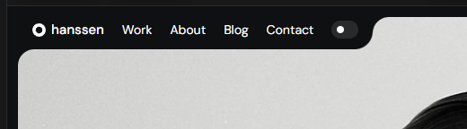

# Hanssen bento geometry reference

The founder selected the Hanssen About presentation for the static customizable
Reception bento on 26 October 2026. Read the
[accepted scope](../../INSCAPE_ACTIVE_CONTRACT.md#static-customizable-reception-bento-direction-2026-10-26)
and [implementation handoff](../../handoffs/2026-10-26-static-reception-bento.md).

## Live references

- Primary: [Hanssen About](https://hanssen-template.framer.website/about).
- Navigation and adjacent presentation: [Hanssen Work](https://hanssen-template.framer.website/work).
- Wider established context: [25 October Hanssen packet](../2026-10-25-hanssen/README.md).

Inspect the live reference as well as the images. On 26 October, the About page
kept the left portrait and compact top-left navigation stationary while the
right-hand personal sections scrolled. Its light/dark toggle changed surfaces
while retaining the same contour and proportions. This task adopts the static
visual grammar, not its animated reveal or moving client-logo strip.

## Saved images

| File | What it establishes |
| --- | --- |
| [Founder close-up](hanssen-navigation-corners-founder.png) | The supplied 520 by 144 image, copied unchanged. The navigation sits in a cutout; the image resumes to its right through a concave join and rounded outer contour. This detail is an explicit requirement. |
| [Dark About](hanssen-about-dark.png) | Live desktop capture from 26 October. Broad image on the left; asymmetric panels, compact gaps and navigation. |
| [Light About](hanssen-about-light.png) | Same live page and geometry in its light theme. Cutouts must not depend on a hard-coded dark background. |
| [Earlier full About capture](../2026-10-25-hanssen/screenshots/02-about-reception.jpg) | Wider 2545 by 1297 reference, including the name-label cutout near the image's bottom-right edge. |

The close-up's SHA-256 is
`a0d6671e809593e4afb84a37112017f1e207af92a9770a1d2824807944bc57b0`.
These are reference captures, not Inscape production assets. Do not copy the
template's portrait, logos, content, font files, Framer runtime or commercial
template source into the application.

## Geometry to preserve

Convex outer corners and concave inner joins must read as one continuous
silhouette. Around the navigation, the exposed image boundary turns around the
navigation footprint; an ordinary rounded rectangle below a detached toolbar
does not reproduce this. Inspect the founder image at native size. The bottom
name label illustrates the same construction in the opposite corner; it is a
geometry example, not a requirement to duplicate the profile name everywhere.

Use real clipping or a geometrically correct equivalent, consistent theme
surfaces, responsive dimensions and deliberate hit areas. Test zero and large
radii, zero and large gutters, long names, wrapped/collapsed navigation, media
under the cutout, and both themes. Negative-space decoration must never cover
controls or intercept a divider drag. Do not round every internal grid junction
into a decorative hole: the inset shape belongs where an actual tab, label or
navigation footprint requires it.
